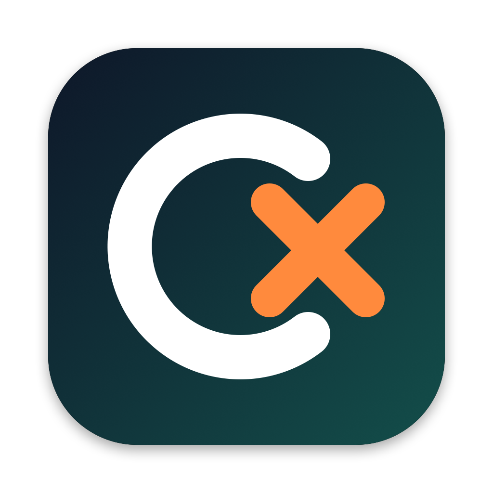

<div align="center">



# ColimaX

A native macOS app for managing Colima and Docker on Apple Silicon.


English · [Tiếng Việt](README.vi.md)

</div>

ColimaX puts the Colima runtime, containers, Compose projects, backups and diagnostics in one window and one menu bar icon. It is written in SwiftUI (Swift 6, strict concurrency), calls the Colima CLI and the Docker Engine API directly over the unix socket, and has no third-party dependencies.

## Why ColimaX

- **Native and lightweight.** A SwiftUI app with no external dependencies; Docker screens talk to the Engine API over the socket instead of shelling out to the `docker` CLI.
- **Colima-aware.** Profiles, VM settings and in-VM resource usage are first-class, not an afterthought of a generic Docker GUI.
- **Safe by default.** Destructive actions require confirmation, commands are never built by string concatenation, secrets are masked, and the security audit is read-only.
- **Data protection built in.** Volume and database backups with checksums, verified restores and scheduled retention.

## Features

### Runtime

- VM status, start / stop / restart; switch Colima profiles from the toolbar or the menu bar.
- Create and delete profiles; change CPU, memory, disk, architecture, container runtime, VM type (vz / qemu / krunkit), mount type (virtiofs / sshfs / 9p), Rosetta, Kubernetes (k3s) and nested virtualization. Changes that require recreating the VM are flagged up front and need confirmation.
- Actual CPU / memory / disk usage inside the VM (read via `colima ssh`) and Docker info.
- Real-time updates via Docker `/events` and kqueue watching of the Colima directory.

### Containers

- Filterable list with start / stop / restart / pause / remove and a health column.
- Details: restart count, restart policy, OOMKilled, exit code, health and latest probe, memory / CPU / PID limits, networks and IPs, mounts, environment variables (sensitive values masked).
- Streaming logs with export to file, inspect JSON, exec commands in a container, open a shell in Terminal.

### Compose

- Discovers projects from labels; add a project from a folder (finds the compose file, overrides and `.env` automatically, without starting anything).
- up / down / start / stop / restart / pull, logs, validate, view the merged config, restart and rebuild individual services.

### Images, volumes and networks

- **Images:** pull with per-layer progress, remove, prune, inspect, architecture column and a warning for non-arm64 images.
- **Volumes:** create, remove, prune, inspect.
- **Networks:** create (driver, subnet, gateway, internal), remove, prune, inspect, connect / disconnect containers.

### Backup

- Back up volumes to `.tar` with a manifest (size, SHA-256); verify backups; restore with verification first.
- Logical database backups via the Docker exec API: MySQL / MariaDB, PostgreSQL, Redis / Valkey / KeyDB. Credentials are only used inside the container.
- Restore a database dump into a container (the file is checked first; confirmation requires typing the container name).
- Scheduled volume / database backups that keep the N most recent copies (Backups screen).
- Elasticsearch / OpenSearch snapshots: create, restore, delete, export the repository.

### Diagnostics and security

- Checks for CLIs, the Docker endpoint, ping, Docker context, configuration drift, VZ / virtiofs / Rosetta, resources and VM disk space.
- Read-only security audit: privileged containers, dangerous capabilities, mounted `docker.sock`, host network / pid / ipc, `unconfined` profiles, ports bound to `0.0.0.0`, secret-like environment variables, socket permissions.
- Detects duplicate published ports and ports already taken by host processes.

### Monitoring and storage

- Per-container CPU / memory / network / block I/O (streamed from `/stats`).
- Disk usage analysis: unused volumes, dangling / unused images, stopped containers, build cache; cleanup with confirmation.
- Background sampling every minute with 3 days of history, and alerts when container CPU / memory or VM disk usage crosses a threshold.

### Tools

- **Topology:** graph of networks and containers, plus Compose `depends_on`.
- **Local Domains:** `<name>.localhost` routed to a container through a Caddy reverse proxy, with HTTPS from a local CA (trusting the CA is optional).
- **Vulnerability scanning** of images with Trivy or Docker Scout, if installed.

## Requirements

| Component | Requirement |
|---|---|
| macOS | 14 or later |
| Hardware | Apple Silicon (arm64) |
| Colima | Required |
| `docker` CLI + compose plugin | Only needed for the Compose screen, the Compose graph and the "open in Terminal" action. Other screens call the Docker Engine API directly |
| Trivy or Docker Scout | Optional, for image vulnerability scanning (`brew install trivy`) |
| Building from source | Swift 6 toolchain (Xcode); tests need Xcode's XCTest |

```bash
brew install colima docker docker-compose
```

On first launch, if any of these tools is missing, the **Setup Assistant** lists what is installed and can run the `brew install` command above for you after you confirm. It does not install Homebrew itself (that needs your administrator password); it shows the official install command to run in Terminal. Open it again any time from the app menu: **Setup Assistant…**.

Coming from **OrbStack** or **Docker Desktop**? The Setup Assistant detects them and, after you confirm each step, points the `docker` CLI context at your Colima profile (with **Switch Back**), replaces Docker Desktop's credential helper with the macOS Keychain, moves aside broken CLI plugin links and can quit the other app. `/var/run/docker.sock` needs `sudo`, so the assistant only shows the command to copy. Images and volumes are not moved: pull or rebuild them on Colima, and back up volume data you need first.

Docker screens only work when the profile uses the `docker` runtime.

## Installation

Pre-release builds are on [GitHub Releases](https://github.com/trongcong/colimax/releases). They are ad-hoc signed and **not notarized by Apple** (an indie project without a paid Apple Developer ID yet).

Install or update with one command ([read the script first](scripts/install.sh); no sudo):

```bash
curl -fsSL https://raw.githubusercontent.com/trongcong/colimax/main/scripts/install.sh | sh
```

It downloads the newest release, checks its SHA-256 and copies ColimaX into `/Applications`. If the GitHub CLI is installed and signed in, it also verifies the build provenance (built by this repository's Release workflow from the release tag) and stops when that check fails. Files downloaded with curl are not quarantined, so Gatekeeper does not prompt: you are trusting this GitHub repository. The `.sha256` file comes from the same release as the DMG, so on its own it only catches a broken download, not a swapped file; the provenance check is what proves where the DMG came from. `COLIMAX_VERSION=1.0.0-beta.2` picks a version; `COLIMAX_APP_DIR=~/Applications` installs elsewhere.

Or download the DMG yourself: drag ColimaX into Applications, open it once, then go to **System Settings → Privacy & Security → Open Anyway** (or run `xattr -dr com.apple.quarantine /Applications/ColimaX.app`). Compare `shasum -a 256 ColimaX-<version>.dmg` with the `.sha256` file. Releases built by GitHub Actions also carry a build provenance attestation: `gh attestation verify ColimaX-<version>.dmg -R trongcong/colimax` proves the DMG was built from this repository.

Or build the app from source:

```bash
scripts/build-app.sh                 # creates build/ColimaX.app (ad-hoc signed, Hardened Runtime)
open build/ColimaX.app
cp -R build/ColimaX.app /Applications/
```

macOS notifications and "open at login" only work in the `.app` bundle (they need a bundle identifier), not with `swift run`.

`scripts/build-app.sh` reads these environment variables:

| Variable | Default | Meaning |
|---|---|---|
| `BUNDLE_ID` | `dev.colimax.ColimaX` | Bundle identifier |
| `VERSION` | contents of the `VERSION` file | `CFBundleShortVersionString` |
| `BUILD_NUMBER` | `1` | `CFBundleVersion` |
| `SIGN_IDENTITY` | `-` (ad-hoc) | Identity passed to `codesign` |

### Signed releases

Builds distributed to other people must be signed with a Developer ID and notarized. One command runs the whole pipeline (tests, build, sign, notarize app, DMG, notarize DMG, SHA-256):

```bash
SIGN_IDENTITY="Developer ID Application: <Name> (<TEAMID>)" NOTARY_PROFILE=<profile> scripts/release.sh
```

Pushing a `vX.Y.Z` tag to GitHub runs the **Release** workflow, which does the same and creates a draft GitHub Release. Without the Developer ID secrets it builds an ad-hoc DMG instead; either way the DMG gets a build provenance attestation. The full process, including first-time certificate setup, is in [docs/RELEASE.md](docs/RELEASE.md).

## Usage

The sidebar has four groups. ⌘1 to ⌘9 follow the sidebar order (`Screen.shortcutOrder`).

| Shortcut | Group | Screen | Contents |
|---|---|---|---|
| ⌘1 | Overview | Dashboard | VM status, start / stop / restart, in-VM CPU / memory / disk, Docker info, disk usage |
| ⌘2 | Overview | Monitoring | Per-container resource usage |
| ⌘3 | Overview | Diagnostics | Runtime, Apple Silicon, security and port checks. Read-only |
| ⌘4 | Docker | Containers | Actions, details (Info / Logs / Inspect / Exec), database backup |
| ⌘5 | Docker | Compose | Projects, project and per-service actions, logs, config |
| ⌘6 | Docker | Images | Pull, remove, prune, inspect, architecture |
| ⌘7 | Docker | Volumes | Volume management, backup, verify, restore |
| ⌘8 | Docker | Networks | Network management, connect / disconnect |
| ⌘9 | Docker | Storage | Disk usage analysis and cleanup |
| — | Tools | Backups | Scheduled volume / database backups |
| — | Tools | Topology | Network and Compose dependency graph |
| — | Tools | Local Domains | `<name>.localhost` reverse proxy |
| — | Settings | Runtime Settings | VM configuration, create / delete profiles |
| — | Settings | Preferences | Appearance, language, Dock icon, open at login, auto-start VM, notifications, monitoring alerts |

Other shortcuts:

- ⌘R: refresh profiles and Docker data.
- ⇧⌘R: rerun Diagnostics (while on the Diagnostics screen).
- ⌘,: the standard macOS Settings window (Preferences content).
- Screens without a number shortcut are available from the sidebar or the **Go** menu.

The menu bar icon lets you switch profiles, start / stop / restart the VM, run quick container actions (open port, logs, restart, stop, start) and open the main window.

## Building and testing

```bash
swift run                            # run a debug build via SwiftPM
scripts/dev-build.sh                 # fast swiftc build that prints every warning
scripts/run-tests.sh                 # unit tests (integration tests skip themselves)
scripts/run-tests.sh --integration   # also run integration tests; needs a running Colima VM
swift test                           # tests via SwiftPM
scripts/check-strings.sh             # localization checks (see below)
scripts/build-app.sh                 # package build/ColimaX.app
```

- Integration tests use the Colima profile in `COLIMAX_PROFILE` (default `default`). They only create resources named `colimax-test-*` with the label `dev.colimax.test` and clean up after themselves.
- `WARNINGS_AS_ERRORS=1 scripts/dev-build.sh` fails on any warning, as CI does. The codebase builds with 0 warnings.

Test strategy, opt-in integration suites and the manual checklist: [docs/TESTING.md](docs/TESTING.md).

## Project structure

```
Sources/ColimaX/
├── App/                  # @main app, main window, menu bar, Preferences, AppStore, AppSettings
├── Core/                 # Shell, BlockingIO, Hashing, Utilities, SystemIntegration
│   ├── Colima/           # ColimaService
│   └── Docker/           # DockerClient, DockerAPI, DockerModels, ContainerDetails
├── UI/                   # Shared SwiftUI components
└── Features/             # One folder per feature: views, services and stores
    ├── Dashboard/
    ├── Runtime/
    ├── Containers/
    ├── Compose/
    ├── Images/           # includes vulnerability scanning
    ├── Volumes/
    ├── Networks/         # includes Topology
    ├── Backup/           # volume / database backup, restore, schedules, Elasticsearch snapshots
    ├── Monitoring/       # stats, background sampling, resource alerts
    ├── Diagnostics/      # diagnostics and Storage
    └── LocalDomains/     # Caddy reverse proxy
Resources/                # App icon, en.lproj and vi.lproj Localizable.strings
Tests/ColimaXTests/       # XCTest: unit tests and conditional integration tests
Tests/Runner/main.swift   # @main entry point used by scripts/run-tests.sh
scripts/                  # build, test, localization, icon, DMG, notarize and release scripts
docs/                     # Architecture, features, roadmap, testing, audit, release, brand
```

## Documentation

| Document | Contents |
|---|---|
| [docs/ARCHITECTURE.md](docs/ARCHITECTURE.md) | Layers, concurrency, endpoints, backup pipeline, design decisions |
| [docs/FEATURES.md](docs/FEATURES.md) | Feature status tracker, the single source of truth for what is implemented and verified |
| [docs/ROADMAP.md](docs/ROADMAP.md) | Pre-release work and plans for later versions |
| [docs/TESTING.md](docs/TESTING.md) | Test strategy, how to run tests, manual checklist |
| [docs/AUDIT.md](docs/AUDIT.md) | Engineering review: risks and gaps |
| [docs/RELEASE.md](docs/RELEASE.md) | Release process: certificates, notarization, DMG, GitHub Release |
| [docs/README.md](docs/README.md) | Index of everything in `docs/` |
| [CONTRIBUTING.md](CONTRIBUTING.md) | Workflow, code standards, commit conventions |
| [CODE_OF_CONDUCT.md](CODE_OF_CONDUCT.md) | Community standards |
| [SECURITY.md](SECURITY.md) | Security model, mitigations, reporting vulnerabilities |
| [CHANGELOG.md](CHANGELOG.md) | Version history |
| [AGENTS.md](AGENTS.md) | Instructions for coding agents |

## Localization

The UI is available in English and Vietnamese (`Resources/en.lproj`, `Resources/vi.lproj`). By default it follows the system language; you can override it in Preferences (takes effect after restarting the app). `scripts/check-strings.sh` lints the string files, flags hard-coded Vietnamese literals in `Sources/ColimaX` and reports localization keys missing from `vi.lproj`.

## Project status

Version 1.0.0 is in beta (`1.0.0-beta.2`, ad-hoc signed); the final release will be signed with a Developer ID and notarized. It builds cleanly (Swift 6 strict concurrency, 0 warnings); unit, integration and UI tests pass against a real Colima VM, and the manual UI checklist has been done. Per-feature status and test results are tracked in [docs/FEATURES.md](docs/FEATURES.md).

## License

MIT. See [LICENSE](LICENSE).

## Disclaimer

ColimaX is an independent project. It is not affiliated with or endorsed by the [Colima](https://github.com/abiosoft/colima) project, and it only calls the Colima CLI already installed on your machine.
