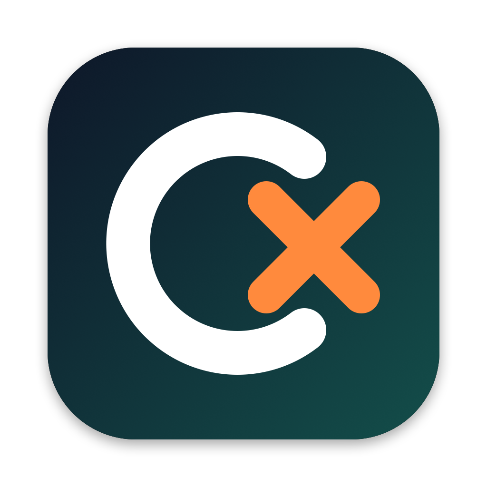

<div align="center">



# ColimaX

Ứng dụng macOS native để quản lý Colima và Docker trên Apple Silicon.


[English](README.md) · Tiếng Việt

</div>

ColimaX gom runtime Colima, container, project Compose, backup và chẩn đoán vào một cửa sổ và một icon menu bar. Ứng dụng viết bằng SwiftUI (Swift 6, strict concurrency), gọi Colima CLI và Docker Engine API trực tiếp qua unix socket, không dùng dependency ngoài.

## Vì sao dùng ColimaX

- **Native và nhẹ.** App SwiftUI không có dependency ngoài; các màn Docker gọi Engine API qua socket thay vì gọi `docker` CLI.
- **Hiểu Colima.** Profile, cấu hình VM và tài nguyên bên trong VM là thành phần chính, không phải phần phụ của một GUI Docker chung chung.
- **An toàn mặc định.** Thao tác destructive cần xác nhận, không chạy lệnh bằng nối chuỗi, giá trị nhạy cảm được che, security audit chỉ đọc.
- **Bảo vệ dữ liệu sẵn có.** Backup volume và database kèm checksum, restore có xác minh, lịch backup có giới hạn số bản giữ lại.

## Tính năng

### Runtime

- Trạng thái VM, start / stop / restart; chọn profile Colima từ toolbar hoặc menu bar.
- Tạo và xoá profile; đổi CPU, RAM, Disk, kiến trúc, container runtime, VM type (vz / qemu / krunkit), mount (virtiofs / sshfs / 9p), Rosetta, Kubernetes (k3s), nested virtualization. Thay đổi cần tạo lại VM được báo trước và hỏi xác nhận.
- CPU / RAM / Disk thực tế bên trong VM (đọc qua `colima ssh`), thông tin Docker.
- Cập nhật realtime qua Docker `/events` và theo dõi thư mục Colima bằng kqueue.

### Containers

- Danh sách có lọc, start / stop / restart / pause / xoá, cột health.
- Chi tiết: restart count, restart policy, OOMKilled, exit code, health và probe gần nhất, giới hạn memory / CPU / PIDs, network và IP, mount, biến môi trường (giá trị nhạy cảm được che).
- Logs stream, export log ra file; inspect JSON; exec lệnh trong container; mở shell trong Terminal.

### Compose

- Phát hiện project qua label và thêm project từ thư mục (tự tìm file compose, override và `.env`, không tự chạy).
- up / down / start / stop / restart / pull; logs; validate; xem config hợp nhất; restart và rebuild từng service.

### Images, Volumes, Networks

- **Images:** pull có tiến trình theo layer, xoá, prune, inspect, cột kiến trúc và cảnh báo image không phải arm64.
- **Volumes:** tạo, xoá, prune, inspect.
- **Networks:** tạo (driver, subnet, gateway, internal), xoá, prune, inspect, connect / disconnect container.

### Backup

- Backup volume ra `.tar` kèm manifest (kích thước, SHA-256); kiểm tra backup; restore có xác minh trước.
- Backup database dạng logic qua Docker exec API: MySQL / MariaDB, PostgreSQL, Redis / Valkey / KeyDB. Credential chỉ được dùng bên trong container.
- Restore database dump vào container (kiểm tra file trước, xác nhận bằng gõ tên container).
- Lịch backup định kỳ cho volume / database, giữ N bản gần nhất (màn Backups).
- Snapshot Elasticsearch / OpenSearch: tạo, restore, xoá, export repository.

### Diagnostics và bảo mật

- Kiểm tra CLI, endpoint Docker, ping, Docker context, lệch cấu hình, VZ / virtiofs / Rosetta, tài nguyên, dung lượng đĩa VM.
- Security audit chỉ đọc: privileged, capability nguy hiểm, mount `docker.sock`, host network / pid / ipc, `unconfined`, port bind `0.0.0.0`, biến môi trường giống secret, quyền socket.
- Phát hiện port trùng và port bị process trên host chiếm.

### Monitoring và dung lượng

- CPU / RAM / Network / Block I/O theo container (stream `/stats`).
- Phân tích dung lượng: volume không dùng, image dangling / không dùng, container đã dừng, build cache; dọn có xác nhận.
- Lấy mẫu nền mỗi phút, lịch sử 3 ngày, cảnh báo khi CPU / RAM container hoặc disk VM vượt ngưỡng.

### Công cụ

- **Topology:** đồ thị network ↔ container và `depends_on` của Compose.
- **Local Domains:** `<tên>.localhost` → container qua reverse proxy Caddy, HTTPS bằng CA nội bộ (tin cậy CA là tuỳ chọn).
- **Quét lỗ hổng image** bằng Trivy hoặc Docker Scout nếu đã cài.

## Yêu cầu hệ thống

| Thành phần | Yêu cầu |
|---|---|
| macOS | 14 trở lên |
| Phần cứng | Apple Silicon (arm64) |
| Colima | Bắt buộc |
| `docker` CLI + plugin compose | Chỉ cần cho màn Compose, đồ thị Compose và nút mở Terminal. Các màn khác gọi Docker Engine API trực tiếp |
| Trivy hoặc Docker Scout | Tuỳ chọn, cho quét lỗ hổng image (`brew install trivy`) |
| Build từ mã nguồn | Swift 6 toolchain (Xcode); test cần XCTest của Xcode |

```bash
brew install colima docker docker-compose
```

Lần mở đầu tiên, nếu thiếu công cụ nào, **Trợ lý cài đặt** liệt kê những gì đã có và có thể chạy lệnh `brew install` ở trên sau khi bạn xác nhận. App không tự cài Homebrew (cần mật khẩu quản trị), chỉ hiện lệnh cài chính thức để chạy trong Terminal. Mở lại bất kỳ lúc nào từ menu app: **Trợ lý cài đặt…**.

Các màn Docker chỉ hoạt động khi profile dùng runtime `docker`.

## Cài đặt

Chưa có bản phát hành build sẵn. Build app từ mã nguồn:

```bash
scripts/build-app.sh                 # tạo build/ColimaX.app (ký ad-hoc, Hardened Runtime)
open build/ColimaX.app
cp -R build/ColimaX.app /Applications/
```

Thông báo macOS và "mở khi đăng nhập" chỉ hoạt động ở bản `.app` (cần bundle identifier), không hoạt động với `swift run`.

Biến môi trường của `scripts/build-app.sh`:

| Biến | Mặc định | Ý nghĩa |
|---|---|---|
| `BUNDLE_ID` | `dev.colimax.ColimaX` | Bundle identifier |
| `VERSION` | nội dung file `VERSION` | `CFBundleShortVersionString` |
| `BUILD_NUMBER` | `1` | `CFBundleVersion` |
| `SIGN_IDENTITY` | `-` (ad-hoc) | Identity cho `codesign` |

### Bản phát hành đã ký

Bản phát hành cho người khác phải ký Developer ID và notarize. Một lệnh làm toàn bộ (test → build → ký → notarize app → DMG → notarize DMG → SHA-256):

```bash
SIGN_IDENTITY="Developer ID Application: <Tên> (<TEAMID>)" NOTARY_PROFILE=<profile> scripts/release.sh
```

Push tag `vX.Y.Z` lên GitHub thì workflow **Release** làm tương tự và tạo GitHub Release dạng draft. Quy trình đầy đủ, kể cả thiết lập chứng chỉ lần đầu: [docs/RELEASE.md](docs/RELEASE.md).

## Sử dụng

Sidebar chia bốn nhóm; ⌘1…⌘9 theo đúng thứ tự sidebar (`Screen.shortcutOrder`). Tên màn hình dưới đây theo giao diện tiếng Anh.

| Phím | Nhóm | Màn hình | Nội dung |
|---|---|---|---|
| ⌘1 | Overview | Dashboard | Trạng thái VM, start / stop / restart, CPU / RAM / Disk trong VM, Docker info, dung lượng |
| ⌘2 | Overview | Monitoring | Tài nguyên theo container |
| ⌘3 | Overview | Diagnostics | Runtime, Apple Silicon, bảo mật, port. Chỉ đọc |
| ⌘4 | Docker | Containers | Thao tác, chi tiết (Info / Logs / Inspect / Exec), backup database |
| ⌘5 | Docker | Compose | Project, thao tác project và từng service, logs, config |
| ⌘6 | Docker | Images | Pull, xoá, prune, inspect, kiến trúc |
| ⌘7 | Docker | Volumes | Quản lý volume, backup, kiểm tra, restore |
| ⌘8 | Docker | Networks | Quản lý network, connect / disconnect |
| ⌘9 | Docker | Storage | Phân tích và dọn dung lượng |
| — | Tools | Backups | Lịch backup volume / database |
| — | Tools | Topology | Đồ thị network và phụ thuộc Compose |
| — | Tools | Local Domains | Reverse proxy `<tên>.localhost` |
| — | Settings | Runtime Settings | Cấu hình VM, tạo / xoá profile |
| — | Settings | Preferences | Giao diện, ngôn ngữ, icon Dock, mở khi đăng nhập, tự start VM, thông báo, cảnh báo monitoring |

Phím khác:

- ⌘R: làm mới profile và dữ liệu Docker.
- ⇧⌘R: chạy lại Diagnostics (khi đang ở màn Diagnostics).
- ⌘,: cửa sổ Settings chuẩn của macOS (nội dung Preferences).
- Màn hình không có phím số mở từ sidebar hoặc menu **Go** (Đi tới).

Menu bar: chọn profile, start / stop / restart VM, thao tác nhanh với container (mở port, logs, restart, stop, start), mở cửa sổ chính.

## Build và test

```bash
swift run                            # chạy bản debug qua SwiftPM
scripts/dev-build.sh                 # build nhanh bằng swiftc, in mọi warning
scripts/run-tests.sh                 # unit test (integration tự skip)
scripts/run-tests.sh --integration   # thêm integration test, cần VM Colima đang chạy
swift test                           # test qua SwiftPM
scripts/check-strings.sh             # kiểm tra bản địa hoá (xem bên dưới)
scripts/build-app.sh                 # đóng gói build/ColimaX.app
```

- Integration test dùng profile Colima trong `COLIMAX_PROFILE` (mặc định `default`). Test chỉ tạo tài nguyên tên `colimax-test-*` có label `dev.colimax.test` và tự dọn.
- `WARNINGS_AS_ERRORS=1 scripts/dev-build.sh` fail khi có warning, giống CI. Mã nguồn build với 0 warning.

Chiến lược test, các bộ integration tuỳ chọn và checklist kiểm thủ công: [docs/TESTING.md](docs/TESTING.md).

## Cấu trúc repo

```
Sources/ColimaX/
├── App/                  # @main, cửa sổ chính, menu bar, Preferences, AppStore, AppSettings
├── Core/                 # Shell, BlockingIO, Hashing, Utilities, SystemIntegration
│   ├── Colima/           # ColimaService
│   └── Docker/           # DockerClient, DockerAPI, DockerModels, ContainerDetails
├── UI/                   # Component SwiftUI dùng chung
└── Features/             # Mỗi tính năng một thư mục: view, service, store
    ├── Dashboard/
    ├── Runtime/
    ├── Containers/
    ├── Compose/
    ├── Images/           # gồm quét lỗ hổng
    ├── Volumes/
    ├── Networks/         # gồm Topology
    ├── Backup/           # backup / restore volume và database, lịch, snapshot Elasticsearch
    ├── Monitoring/       # stats, lấy mẫu nền, cảnh báo tài nguyên
    ├── Diagnostics/      # chẩn đoán và Storage
    └── LocalDomains/     # reverse proxy Caddy
Resources/                # Icon app, Localizable.strings en.lproj và vi.lproj
Tests/ColimaXTests/       # XCTest: unit + integration có điều kiện
Tests/Runner/main.swift   # @main cho scripts/run-tests.sh
scripts/                  # build, test, bản địa hoá, icon, DMG, notarize, phát hành
docs/                     # Kiến trúc, tính năng, roadmap, test, audit, phát hành, brand
```

## Tài liệu

Tài liệu chính viết bằng tiếng Anh.

| File | Nội dung |
|---|---|
| [docs/ARCHITECTURE.md](docs/ARCHITECTURE.md) | Tầng, concurrency, endpoint, backup pipeline, quyết định thiết kế |
| [docs/FEATURES.md](docs/FEATURES.md) | Trạng thái tính năng, nguồn sự thật duy nhất |
| [docs/ROADMAP.md](docs/ROADMAP.md) | Việc trước phát hành và kế hoạch các bản sau |
| [docs/TESTING.md](docs/TESTING.md) | Chiến lược test, cách chạy, checklist kiểm thủ công |
| [docs/AUDIT.md](docs/AUDIT.md) | Engineering review: rủi ro và gap |
| [docs/RELEASE.md](docs/RELEASE.md) | Quy trình phát hành: chứng chỉ, notarize, DMG, GitHub Release |
| [docs/README.md](docs/README.md) | Mục lục thư mục `docs/` |
| [CONTRIBUTING.md](CONTRIBUTING.md) | Quy trình, chuẩn code, quy ước commit |
| [CODE_OF_CONDUCT.md](CODE_OF_CONDUCT.md) | Quy tắc ứng xử |
| [SECURITY.md](SECURITY.md) | Mô hình bảo mật, biện pháp, báo lỗ hổng |
| [CHANGELOG.md](CHANGELOG.md) | Lịch sử phiên bản |
| [AGENTS.md](AGENTS.md) | Hướng dẫn cho coding agent |

## Bản địa hoá

Giao diện có tiếng Anh và tiếng Việt (`Resources/en.lproj`, `Resources/vi.lproj`). Mặc định theo ngôn ngữ hệ thống; có thể chọn ngôn ngữ khác trong Preferences (có hiệu lực sau khi mở lại app). `scripts/check-strings.sh` kiểm tra file strings, phát hiện chuỗi tiếng Việt viết cứng trong `Sources/ColimaX` và báo key còn thiếu trong `vi.lproj`.

## Trạng thái dự án

Bản 1.0.0 chưa phát hành. Build sạch (Swift 6 strict concurrency, 0 warning); unit test, integration test và UI test đều pass trên VM Colima thật, checklist kiểm tay giao diện đã làm xong. Trạng thái từng tính năng và kết quả test: [docs/FEATURES.vi.md](docs/FEATURES.vi.md).

## Giấy phép

MIT — xem [LICENSE](LICENSE).

## Tuyên bố

ColimaX là dự án độc lập, không liên kết và không được bảo trợ bởi dự án [Colima](https://github.com/abiosoft/colima). ColimaX chỉ gọi Colima CLI đã cài sẵn trên máy người dùng.
